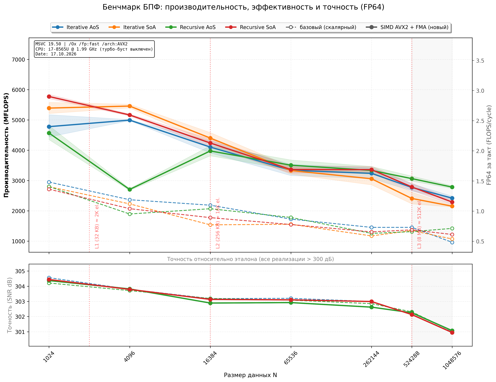

# Vibe FFT

Рекурсивная и итеративная SoA и AoS реализации быстрого преобразования Фурье (БПФ) с

* Автовекторизацией (AVX2, AVX512f) для GCC/Clang
* Ручной реализацией на интринсиках AVX2 + FMA для MSVC (см. [Ручные SIMD-ядра](#ручные-simd-ядра-avx2--fma))

### Требования

* **Стандарт:** C++23
* **Компилятор:** GCC 13+, Clang 16+ или MSVC 19.35+
* **Архитектура:** x86-64 с поддержкой AVX2 (v3)

### Сборка и запуск

Проект использует CMake и настроен на максимальную производительность (O3, AVX2, FMA):

```bash
mkdir build && cd build
cmake -DCMAKE_BUILD_TYPE=Release ..
cmake --build .
./fft_app
```

## Ручные SIMD-ядра (AVX2 + FMA)

### Зачем

При `/arch:AVX2 /fp:fast /Ox` MSVC **практически не автовекторизует** циклы бабочек.
Ассемблер ядра `apply_layer_soa_fwd` состоит из скалярных инструкций
`vmovsd` / `vmulsd` / `vaddsd`, то есть ~0.8 FLOPS на такт вместо теоретических
~16 для AVX2 + FMA (2 FMA-порта × 4 × f64 × 2).

Поэтому ядра БПФ написаны вручную на интринсиках. Скалярные версии оставлены как
fallback для сборок без AVX2 (макрос `FFT_SIMD_AVX2`) и для обработки «хвостов».

### Что реализовано

`simd_kernels.hpp` — общие ядра, поверх них четыре движка:

| Класс | Раскладка | Алгоритм |
|---|---|---|
| `FFTIterativeSoA_SIMD` | SoA | итеративный |
| `FFTIterativeAoS_SIMD` | AoS | итеративный |
| `FFTRecursiveSoA_SIMD` | SoA | рекурсивный |
| `FFTRecursiveAoS_SIMD` | AoS | рекурсивный |

Выбираются через `FFTType::IterativeSimd` / `FFTType::RecursiveSimd`:

```cpp
FFTFactory factory(N);
auto fft = factory.create(FFTLayout::SoA, FFTType::RecursiveSimd);
```

Ключевые решения:

*   **SoA-бабочка** — 4 бабочки за итерацию AVX2. Комплексное умножение:
    `tr = fmsub(hr, wr, hi*wi)`, `ti = fmadd(hr, wi, hi*wr)`.
*   **AoS-бабочка** — 2 бабочки за итерацию, **без дайэринтерлива**:
    `Wr = movedup_pd(W)`, `Wi = permute_pd(W, 0b1111)`, `Vs = permute_pd(V, 0b0101)`,
    `T = addsub_pd(Wr*V, Wi*Vs)`. Цена — 3 перестановки на 2 бабочки (порт 5),
    зато нет ни промежуточной раскладки, ни лишней памяти.
*   **Слои `len = 2` и `len = 4`** — отдельные ядра с фиксированными множителями
    `{1, ∓i}` (перестановка через `permute4x64_pd` + `blend_pd`).
*   **Bit-reversal** — узкое место: на N = 2²⁰ наивный цикл `std::swap` давал
    **~40 %** времени. Транспозиции независимы, поэтому они выполняются пачками по 4
    (16 независимых загрузок «в полёте» → memory-level parallelism) с предзагрузкой
    адресов на 3 пачки вперёд. Ускорение — **2.4–3.1x**.
*   **Кэш-блокирование** (`FFT_SIMD_BLOCK = 512`). Слой `len` комбинирует элементы
    только внутри непрерывного участка длиной `len`, поэтому все слои с `len ≤ 512`
    выполняются внутри блока, пока он resident в L1. Это заменяет `log2(512) = 9`
    полных проходов по памяти одним: для N = 2²⁰ — 12 проходов вместо 20.
    Без блокирования итеративные движки проигрывали рекурсивным в ~1.4x,
    хотя считают ровно то же самое.

### Результаты (i7-8565U, MSVC 14.50, `/Ox /fp:fast /arch:AVX2`, forward + inverse + нормировка)

Ускорение = время базовой (скалярной) реализации / время SIMD-движка.
Замеры сняты при **отключённом Turbo Boost** (фиксированная частота ~1.99 ГГц);
исходные данные — в `assets/results.csv`.

| N | Iterative AoS | Iterative SoA | Recursive AoS | Recursive SoA |
|---|---|---|---|---|
| 1024 | x1.62 | x1.93 | x1.63 | x2.13 |
| 4096 | x2.11 | x2.45 | x1.43 | x2.49 |
| 16384 | x1.88 | x2.86 | x1.92 | x2.39 |
| 65536 | x1.93 | x2.14 | x1.97 | x2.17 |
| 262144 | x2.23 | x2.61 | x2.66 | x2.58 |
| 524288 | x1.91 | x1.78 | x2.33 | x2.03 |
| 1048576 | x2.52 | x2.01 | x1.96 | x1.88 |

Среднее по всем 28 комбинациям — **2.13x**. Точность не деградировала:
SNR ≥ 301 дБ, L∞ ≤ 3.3e-12 на всех размерах.

### Контроль: сколько выигрыша зависит от компилятора

MSVC не автовекторизует базовые циклы, поэтому естественный вопрос — какая часть
ускорения приходится на сами ядра, а какая на то, что компилятор их не векторизует.
Контрольный замер: та же машина, та же фиксированная частота (турбо выключен),
**те же флаги** (`/O2 /Ox /fp:fast /arch:AVX2`), тот же ABI и рантайм — отличается
только оптимизатор: `cl.exe` против `clang-cl` 23.1.3. Для `clang-cl` в
`CMakeLists.txt` срабатывает та же ветка `if(MSVC)`, так что набор флагов идентичен.

Ассемблер подтверждает разницу: под `clang-cl` **базовые** `iterative_fft_soa.cpp` и
`recursive_fft_aos.cpp` содержат `vmulpd` / `vaddpd` / `vfmadd213pd`, то есть
авто-векторизация проходит. `#pragma GCC ivdep` при этом clang игнорирует как
неизвестный — выигрыш получен без хинтов.

Отношения времён (меньше 1 — clang быстрее), по надёжным замерам N ≥ 65536:

| | разброс | среднее |
|---|---|---|
| базовые (скалярные) | 0.50 … 0.85 | 0.66 |
| ручные SIMD-ядра | 0.94 … 1.15 | 1.03 |

Ускорение от ручных ядер по семействам:

| Семейство | MSVC | clang-cl |
|---|---|---|
| Iterative AoS | 2.15x | 1.52x |
| Iterative SoA | 2.14x | 1.23x |
| Recursive AoS | 2.23x | 1.54x |
| Recursive SoA | 2.17x | 1.16x |

Выводы:

*   **Примерно половина выигрыша под MSVC — компенсация отсутствия авто-векторизации.**
    Худший случай — Iterative SoA (2.14x → 1.23x): там clang вытягивает почти всё сам.
*   **На AoS ядра оправданы и под clang** (+52 % / +54 %): трюк без дайэринтерлива
    (`movedup_pd` / `permute_pd` / `addsub_pd`) авто-векторизатор не изобретёт.
    На SoA выигрыш скромнее, потому что данные и так непрерывные.
*   **Главный аргумент — независимость от компилятора.** Базовые реализации гуляют
    между компиляторами вдвое (0.50–0.85), ручные ядра — в пределах ±15 %
    (0.94–1.15). На N = 2²⁰ лучший результат MSVC 75.7 мс против 73.0 мс у clang,
    тогда как базовые там 106–220 мс.

Исходные данные контрольного прогона — `assets/results_clang.csv`.

### Что осталось за кадром

При N ≥ 2²⁰ движки упираются в пропускную способность памяти, а не в арифметику.
Дальнейшие шаги — уже алгоритмические, а не SIMD:

*   **Radix-4 ядро** — вдвое меньше проходов по памяти при меньшем числе операций.
*   **Four-step / six-step БПФ** для больших N — ~2·√N кэш-дружественных шагов.

### FFT Performance & Accuracy Test, std::complex\<double\> (AoS)

* Компилятор MSVC 19.50 [скрипт python](./assets/bench_visualize.py).



### Методология тестирования производительности

Для обеспечения воспроизводимости и точности замеров в проекте используются следующие техники:

*   **Thread Affinity (Привязка к ядру):** Основной поток принудительно закрепляется за логическим ядром ЦПУ (`Core 0`).
*   **Warm-up (Разогрев):** Перед каждым замером выполняется серия итераций алгоритма «вхолостую». Turbo Boost отключен, стабилизированная частота ЦПУ - 1.99 ГГц.
*   **Метрики производительности:**
    *   **MFLOPS:** Рассчитывается на основе теоретической сложности БПФ: $10 \cdot N \log_2(N) + N$ операций на полный цикл (прямое + обратное преобразование + нормировка).
    *   **FLOPS/Cycle:** Количество операций с плавающей точкой FP64 на один такт процессора.
*   **Контроль точности:**
    *   **SNR (Signal-to-Noise Ratio):** Отношение энергии исходного сигнала к энергии ошибки восстановления (в дБ).
    *   **L-inf (Чебышёвская норма):** Максимальное абсолютное отклонение между исходным и восстановленным вектором. Значение `OK` выставляется при $L_{\infty} < \epsilon$, где допуск $\epsilon$ масштабируется согласно $O(\log_2 N)$ и учитывает использование агрессивных математических оптимизаций (`/fp:fast`).
